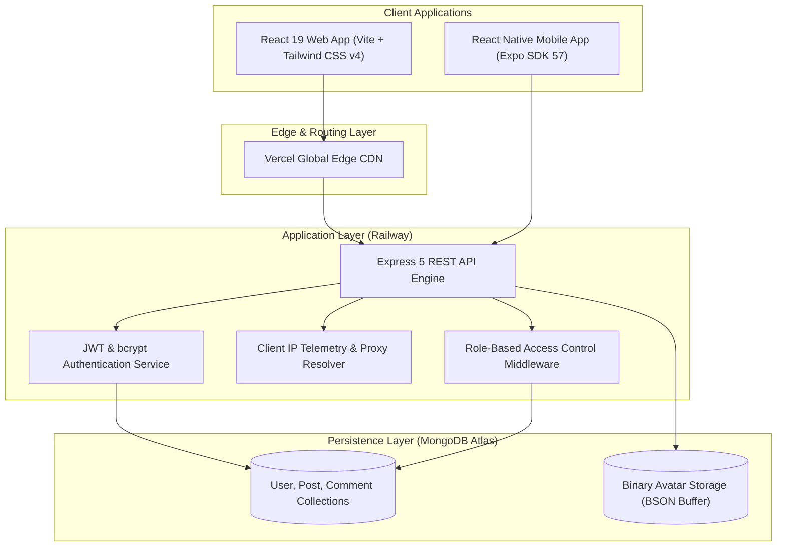
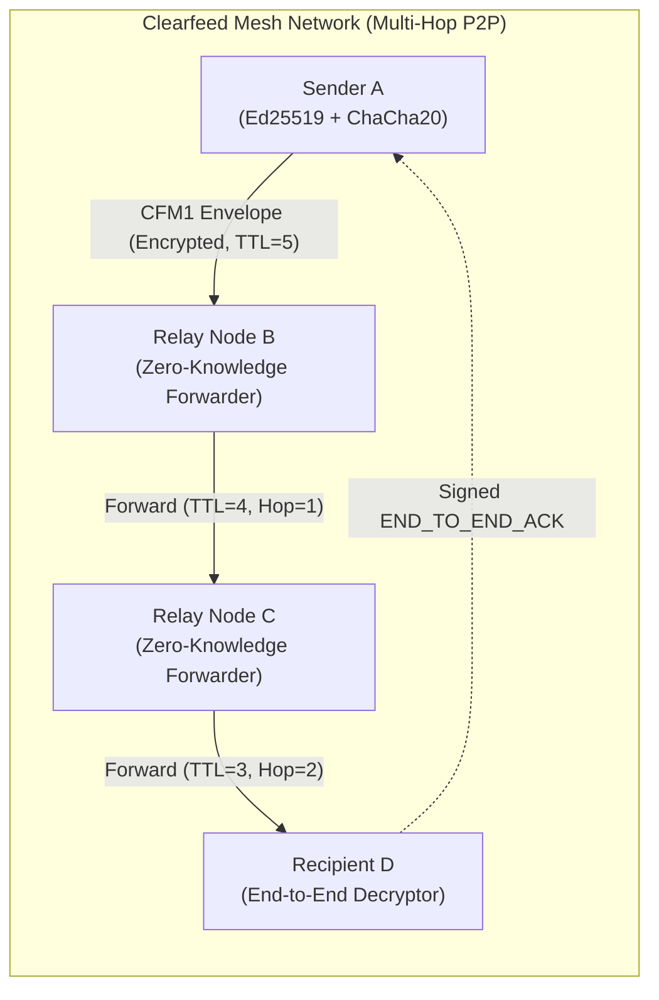

# 🌿 Clearfeed — The Anti-Algorithm Social Platform & Developer Studio

<div align="center">

[](https://clearfeed-web.vercel.app/)
[](https://clearfeed518.up.railway.app)
[](https://react.dev/)
[](https://nodejs.org/)
[](https://www.mongodb.com/)
[](LICENSE)

**"Unfiltered. Chronological. Yours."**  
A high-performance full-stack social network and developer code studio engineered for thinkers, writers, and software engineers. Free from engagement manipulation, vanity algorithmic feeds, and tracking surveillance.

[**Explore Live Web Application »**](https://clearfeed-web.vercel.app/) · [Report Bug](https://github.com/Nasir-Yousuf/social-media-application/issues) · [Request Feature](https://github.com/Nasir-Yousuf/social-media-application/issues)

</div>

---

## 📑 Table of Contents

- [Executive Summary](#-executive-summary)
- [System Architecture](#-system-architecture)
- [Key Engineering Highlights](#-key-engineering-highlights)
- [Core Features](#-core-features)
- [Clearfeed Mesh: Standalone Offline P2P Subsystem](#-clearfeed-mesh-standalone-offline-p2p-subsystem)
- [Tech Stack](#-tech-stack)
- [API Architecture](#-api-architecture)
- [Zero-Cloud-Cost Storage Engine](#-zero-cloud-cost-storage-engine)
- [Security & Administrative Governance](#-security--administrative-governance)
- [Mobile Application (React Native + Expo)](#-mobile-application-react-native--expo)
- [Local Development & Setup](#-local-development--setup)
- [Cloud Deployment Guide](#-cloud-deployment-guide)
- [Engineering Decisions & Trade-Offs](#-engineering-decisions--trade-offs)
- [Authors & Core Maintainers](#-authors--core-maintainers)

---

## 💡 Executive Summary

Modern social networks are architected around algorithmic feedback loops, outrage amplification, and opaque ranking signals designed to maximize screen time rather than substantive discourse.

**Clearfeed** re-engineers social interaction from first principles:

- **Strictly Chronological Timeline**: Posts appear in the exact order they are created. No shadow-boosting, no engagement downranking.
- **Developer First**: Native **VS Code-styled Multi-File CodeHub Studio** for sharing, inspecting, and 1-click remixing real codebases alongside technical discussions.
- **Zero-Cloud-Cost Scalability**: Engineered with custom client-side HTML5 canvas compression and MongoDB binary stream avatars, eliminating AWS S3/Cloudinary monthly billing.
- **Enterprise-Grade Governance**: Multi-tenant role-based access control (RBAC), multi-maintainer protection, reverse-proxy-aware client IP telemetry, and active audit logging.

---

## 🏗️ System Architecture



---

## ⚡ Key Engineering Highlights

| Highlight                            | Description                                                                                                                                       |
| :----------------------------------- | :------------------------------------------------------------------------------------------------------------------------------------------------ |
| **Full-Stack Reactive Architecture** | Built with **React 19**, **Express 5**, and **Mongoose 8** with full end-to-end type safety, modern async middleware, and optimistic UI updates.  |
| **Client-Side Image Pre-Processing** | Canvas-based downscaling resizes profile photos to 128×128 JPEG at ≤100KB before transmission, reducing network payload by ~95%.                  |
| **Reverse-Proxy-Aware IP Telemetry** | Extracts and normalizes genuine client IP addresses through Cloudflare, Vercel, and Railway headers (`CF-Connecting-IP`, `X-Forwarded-For`).      |
| **Maintainer Governance Safeguards** | Designated site maintainers are cryptographically shielded from unauthorized role changes, suspension, or deletion. |
| **Mobile Parity**                    | Standalone iOS & Android application built with React Native and Expo featuring Twitter's "Lights Out" design system and native gesture handling. |
| **Clearfeed Mesh (Offline P2P)**     | Autonomous multi-hop peer-to-peer communication engine using **Ed25519**, **X25519**, and **ChaCha20-Poly1305** for zero-cloud, account-free offline messaging. |

---

## 🌟 Core Features

### 1. 🌿 The Chronological Feed & Calm Reading Experience

- **Pure Chronology**: Guaranteed time-ordered feed with an explicit "No Algorithm" banner.
- **Substance-Over-Soundbites**: 2,000-character thoughtful limit rendered with custom serif typography (`Source Serif 4`) for distraction-free reading.
- **Anti-Doomscrolling**: Deliberate pagination buttons instead of infinite scroll traps.
- **Quiet Engagements**: Appreciate, Respond, Bookmark, and Share without performative metrics.

### 2. 💻 Multi-File CodeHub Studio

- **VS Code Interface**: Tabbed file switcher mirroring the IDE experience with syntax highlighting and file-type icons.
- **Multi-File Projects**: Share HTML, CSS, JavaScript, TypeScript, Python, SQL, and React components in a single post.
- **1-Click Remix & Fork**: Clone any shared code snippet directly into your composer with automatic author attribution.

### 3. 🛡️ Administrative Governance & Security Dashboard

- **Role-Based Access Control**: Instant permission toggles (`admin` vs. `student`/member).
- **Live Traffic & IP Audit Logs**: Real-time inspection of IP addresses attached to registrations, logins, posts, and comments.
- **Platform Integrity**: Post deletion across the network, user suspension controls, and site-wide announcement broadcasts.
- **Maintainer Safeguards**: Primary platform maintainers hold non-demotable administrative status to protect application infrastructure.

### 4. 🔖 Personal Knowledge Base & Bookmarks

- Privately bookmark posts, technical guides, and code snippets to `/bookmarks`.
- Instant search and filtering across saved entries.

### 5. 👥 Community Directory & Member Profiles

- Public profiles displaying user bio, technical interests, role badges, and custom status lines (e.g. `🔨 Building a compiler`).
- Community directory with real-time search and role filtering.

---

## 📡 Clearfeed Mesh: Standalone Offline P2P Subsystem

**"Connect nearby. Communicate offline."**

Clearfeed Mesh is a real, sovereign, offline-first peer-to-peer communication engine built directly into Clearfeed. It enables devices to discover each other, establish secure cryptographic sessions, exchange end-to-end encrypted messages, and forward packets across intermediate hops without cell service, internet connectivity, or central servers.



### 1. Architectural Independence & Decoupling

Clearfeed Mesh is engineered with an uncompromising architectural boundary:
- **Zero Cloud Coupling**: Mesh operates completely independent of the online MongoDB database, Express API, Socket.io server, and JWT authentication service.
- **Account-Free Onboarding**: Users can launch Clearfeed Mesh in basements, hostels, remote rural locations, or emergency blackout zones and communicate immediately without registering or signing into a central account.
- **Strict Privacy Isolation**: Local Mesh messages and cryptographic private keys are never automatically synchronized to or stored on the Clearfeed cloud backend.
- **Preserved Online Stack**: The existing online social timeline, messaging, and audio lounge continue operating unchanged.

### 2. Cryptographic Architecture & Primitives

Clearfeed Mesh implements an audited, zero-dependency cryptographic foundation using modern primitives with zero custom algorithms:

| Layer | Primitive | Purpose | Implementation |
| :--- | :--- | :--- | :--- |
| **Identity & Signing** | **Ed25519** (256-bit) | Local public key identities and digital packet signing | `@noble/curves/ed25519` |
| **Key Agreement** | **X25519** (Montgomery) | Ephemeral / Static Diffie-Hellman key exchange via curve conversion | `@noble/curves/ed25519` |
| **Payload Encryption** | **ChaCha20-Poly1305** | Authenticated symmetric encryption (AEAD) with 12-byte random nonces | `@noble/ciphers/chacha` |
| **Key Derivation** | **SHA-256** | Shared DH point hashing and safety fingerprint generation | `@noble/hashes/sha2` |
| **Safety Fingerprints** | `XXXX : XXXX : XXXX : XXXX` | Human-verifiable key verification to prevent Man-in-the-Middle (MitM) attacks | Formatted hex blocks |

- **Zero-Knowledge Relays**: Because payloads are encrypted with the recipient's derived symmetric key, intermediate nodes forwarding packets have **zero access** to message plaintext or private keys.
- **Integrity Enforcement**: Any packet with altered ciphertext is cryptographically rejected by the Poly1305 authenticator before reaching the recipient application layer.

### 3. Clearfeed Mesh v1 (CFM1) Wire Protocol

The language-neutral, versioned wire protocol is defined for cross-platform interoperability across React Native, Web, and desktop runtimes:

```
+-----------------------------------------------------------------------------------+
|  MAGIC: "CFM1" (4 bytes: 0x43, 0x46, 0x4D, 0x31)                                 |
|  VERSION: 1 (uint8)                                                              |
|  TYPE: uint8 (0x01: BEACON, 0x02: ANNOUNCE, 0x04: ROUTED_DATA,                  |
|               0x05: HOP_ACK, 0x06: END_TO_END_ACK, 0x07: PING)                   |
|  PACKET_ID: string (16-byte random hex / UUID)                                    |
|  SENDER_PUBKEY: 64-char hex (32-byte Ed25519 public key)                          |
|  RECIPIENT_PUBKEY: 64-char hex (32-byte Ed25519, or 'ffff...ffff' for broadcast)  |
|  HOPS_REMAINING: uint8 (mutable TTL, default: 5, decremented per relay)          |
|  HOP_COUNT: uint8 (mutable counter, starts at 0, incremented per relay)          |
|  TIMESTAMP: uint64 (epoch ms)                                                    |
|  EXPIRES_AT: uint64 (epoch ms, default: 24h TTL)                                 |
|  PAYLOAD: { ciphertextHex, nonceHex, senderNickname }                            |
|  SIGNATURE: 128-char hex (Ed25519 signature of immutable header fields + payload) |
+-----------------------------------------------------------------------------------+
```

- **Signature Separation**: Senders sign immutable header fields (`magic`, `version`, `type`, `packetId`, `senderPubkey`, `recipientPubkey`, `timestamp`, `expiresAt`, `payload`). Relays decrement `hopsRemaining` and increment `hopCount` in transit without invalidating the sender's cryptographic signature.

### 4. Multi-Hop Routing, Store-and-Forward & Loop Prevention

1. **Direct vs. Relayed Routing**:
   - If the recipient's node is directly reachable via single-hop wireless, packets are delivered immediately.
   - If the recipient is out of physical radio range, neighboring peers running Clearfeed Mesh forward the encrypted envelope across up to 5 hops.
2. **Loop Prevention & Deduplication**:
   - Every node maintains an encrypted deduplication cache (`@cfm_seen_packets_v1`).
   - Packets already processed or forwarded are immediately dropped to prevent broadcast storms and infinite routing loops.
3. **Store-and-Forward Bounded Outbox**:
   - In intermittent or disconnected conditions, packets are queued in a bounded relay cache (`@cfm_relay_cache_v1`, capped at 50 packets). Expired packets (`expiresAt < Date.now()`) are automatically purged to prevent local storage bloat.
4. **Relay Participation Controls**:
   - Users can toggle **"Participate in Multi-Hop Relay"** on or off in settings. Users who disable forwarding can still send and receive direct messages.

### 5. Honest Delivery States

Clearfeed Mesh refuses to fabricate delivery status. A successful radio write is not proof that the recipient received the message. The interface reflects genuine delivery phases:

| Status | Badge | Description |
| :--- | :--- | :--- |
| **Saved Locally** | 💾 `Saved Locally` | Encrypted and written to local device storage. |
| **Queued** | ⏳ `Queued for Route` | In device outbox awaiting compatible peer connectivity. |
| **Sent to Neighbor** | 📡 `Sent to Neighbor` | Transmitted over local wireless to an adjacent node. |
| **Relayed** | 🔀 `Relayed` | Forwarded across one or more intermediate mesh hops. |
| **Acknowledged** | ✔️✔️ `Acknowledged` | **Recipient verified ciphertext and returned a signed `END_TO_END_ACK`.** |
| **Failed / Expired** | ⚠️ `Failed / Expired` | Packet reached its TTL limit without route discovery. |

### 6. Standalone Mobile Interface & Navigation

Clearfeed Mesh is accessible from multiple ergonomic entry points:
- **Offline Direct Launch**: Users can tap **"Open Mesh Chat (Offline)"** on the Login screen (`LoginScreen.jsx`) to enter Mesh directly without an account or internet.
- **Dedicated Navigation**: Four dedicated screens in `mobile/src/screens/mesh/`:
  - `MeshHomeScreen`: Status cards, local identity pill, nearby peer counts, and recent encrypted threads.
  - `MeshPeersScreen`: Discovered nodes, direct vs. relay reachability, and fingerprint verification modals.
  - `MeshConversationScreen`: Real-time encrypted chat with honest delivery badges.
  - `MeshSettingsScreen`: Nickname editor, relay toggle, battery saving mode, wire protocol diagnostics, and total storage wipe.
- **Quick Switchers**: Direct Mesh access buttons in both `MessagesScreen.jsx` and `SettingsScreen.jsx`.

### 7. Automated Protocol & Cryptographic Test Suite

Clearfeed Mesh includes an automated, self-contained test suite in `mobile/src/mesh/__tests__/mesh.test.js`:

```bash
# Run the 16-test Mesh protocol & crypto suite:
npm run test:mesh
```

**Verified Test Invariants (16/16 Passed)**:
- [x] Keypair generation (32-byte Ed25519 secret/public keys).
- [x] Fingerprint formatting and collision avoidance.
- [x] CFM1 envelope creation, magic byte validation, and field checking.
- [x] Ed25519 digital signature signing and verification.
- [x] Tampered envelope rejection (altering recipient pubkey fails signature).
- [x] ChaCha20-Poly1305 end-to-end payload encryption and decryption.
- [x] Zero-knowledge relay verification (relay Charlie cannot decrypt Alice's message to Bob).
- [x] Altered ciphertext rejection by Poly1305 authenticator.
- [x] Multi-hop store-and-forward relay simulation (TTL decremented, hop count incremented).
- [x] Cryptographic end-to-end receipt verification (`END_TO_END_ACK` signed by destination).

### 8. Desktop Interoperability Roadmap (Tauri + Rust)

Clearfeed Mesh is designed for cross-platform desktop interoperability:
- **Architecture**: [Tauri](https://tauri.app/) with React frontend and Rust native core.
- **Rust Parity**: The CFM1 wire protocol and `@noble` cryptography map 1:1 with standard Rust crates:
  - `ed25519-dalek` for Ed25519 signing and verification.
  - `x25519-dalek` for Diffie-Hellman key agreement.
  - `chacha20poly1305` for AEAD payload encryption.
- **Uniform Protocol**: Mobile and desktop clients interoperate seamlessly over the shared CFM1 packet format.

---

## 🛠️ Tech Stack

### Web Frontend

- **Framework**: [React 19](https://react.dev/) + [Vite 8](https://vitejs.dev/)
- **Styling**: [Tailwind CSS v4](https://tailwindcss.com/) + Custom CSS Design System Tokens
- **Icons**: [Lucide React](https://lucide.dev/)
- **Date Handling**: [Date-fns](https://date-fns.org/)
- **Routing**: [React Router DOM v7](https://reactrouter.com/)
- **Deployment**: [Vercel](https://vercel.com/) Edge Network

### Backend API

- **Runtime**: [Node.js](https://nodejs.org/) (ES Modules & CommonJS compatibility)
- **Web Framework**: [Express 5](https://expressjs.com/)
- **Database ODM**: [Mongoose 8](https://mongoosejs.com/)
- **Authentication**: Stateless JSON Web Tokens ([jsonwebtoken](https://github.com/auth0/node-jsonwebtoken)) + [bcryptjs](https://github.com/dcodeIO/bcrypt.js)
- **Security & Logging**: Custom IP middleware, CORS configuration, Morgan HTTP request logger
- **Deployment**: [Railway](https://railway.app/) PaaS

### Database

- **Primary Database**: [MongoDB Atlas](https://www.mongodb.com/atlas) (M0 Free Tier)
- **Local Fallback**: Embedded `mongodb-memory-server` for instant offline zero-config development

### Mobile Application (`mobile/`)

- **Framework**: [React Native 0.86](https://reactnative.dev/)
- **Tooling**: [Expo SDK 57](https://expo.dev/)
- **Navigation**: React Navigation v7 (Bottom Tabs & Native Stack)
- **Offline Mesh Cryptography**: [@noble/curves](https://github.com/paulmillr/noble-curves) (Ed25519, X25519) + [@noble/ciphers](https://github.com/paulmillr/noble-ciphers) (ChaCha20-Poly1305) + [@noble/hashes](https://github.com/paulmillr/noble-hashes) (SHA-256)
- **Mesh Wire Protocol**: Clearfeed Mesh v1 (CFM1) Multi-Hop Router with Zero-Knowledge Forwarding
- **Storage**: AsyncStorage with isolated `@cfm_*` partitions for local cryptographic identity, offline conversations, outbox queues, and relay cache

---

## 🔌 API Architecture

| Endpoint                      |  Method  |     Access     | Description                                       |
| :---------------------------- | :------: | :------------: | :------------------------------------------------ |
| `/api/auth/register`          |  `POST`  |     Public     | Register new member with client IP tracking       |
| `/api/auth/login`             |  `POST`  |     Public     | Authenticate user, update session IP, return JWT  |
| `/api/auth/me`                |  `GET`   |    Private     | Retrieve authenticated profile and refresh roles  |
| `/api/posts`                  |  `GET`   |     Public     | Fetch chronological posts with pagination         |
| `/api/posts`                  |  `POST`  |    Private     | Create text/code post with IP attribution         |
| `/api/posts/:id`              | `DELETE` | Author / Admin | Remove post and cascade delete comments           |
| `/api/posts/:id/comments`     |  `POST`  |    Private     | Add comment with IP tracking                      |
| `/api/users/:id/avatar`       |  `GET`   |     Public     | Stream binary avatar buffer with HTTP caching     |
| `/api/users/:id/avatar`       |  `PUT`   |    Private     | Upload compressed JPEG avatar buffer              |
| `/api/admin/users`            |  `GET`   |     Admin      | Fetch user directory with IP audit data           |
| `/api/admin/traffic`          |  `GET`   |     Admin      | Stream live IP traffic and security events        |
| `/api/admin/users/:id/role`   | `PATCH`  |     Admin      | Toggle admin status (protected against co-admins) |
| `/api/admin/users/:id/status` | `PATCH`  |     Admin      | Toggle account suspension                         |

---

## 💾 Zero-Cloud-Cost Storage Engine

Standard web applications often rely on paid third-party asset storage services like Amazon S3 or Cloudinary. Clearfeed completely avoids recurring infrastructure bills through an efficient binary buffer pipeline:

1. **Client-Side Compression**: The browser or mobile app utilizes an HTML5 Canvas to downscale uploaded images to 128×128 JPEG (quality ~0.8), guaranteeing file sizes stay ≤ 100 KB.
2. **Direct BSON Binary Storage**: The binary buffer is uploaded directly via Express and saved into the user's MongoDB document (`avatarData: Buffer`, `avatarMimeType: String`).
3. **Optimized Delivery**: Avatars are served through `GET /api/users/:id/avatar` with:
   - `Cache-Control: public, max-age=86400, stale-while-revalidate=43200`
   - Automated HTTP `304 Not Modified` handling.
4. **Capacity**: Over **5,000 active avatars** can comfortably fit within MongoDB Atlas’s free 512 MB tier.

---

## 🛡️ Security & Administrative Governance

- **Multi-Proxy IP Telemetry**: Real-world web traffic routes through reverse proxies (Vercel, Cloudflare, Railway). Clearfeed implements a robust IP resolver:
  ```javascript
  const getClientIp = (req) => {
    const forwarded = req.headers["x-forwarded-for"];
    if (forwarded) return forwarded.split(",")[0].trim();
    return (
      req.headers["cf-connecting-ip"] ||
      req.socket?.remoteAddress ||
      "127.0.0.1"
    );
  };
  ```
- **Maintainer Safeguards**: Primary platform maintainers possess immutable administrative rights in the backend controllers, preventing accidental demotion, suspension, or deletion.
- **Strict Role-Based Middleware**: Sensitive administrative endpoints require verified JWT authentication and validated `role === 'admin'`.

---

## 📱 Mobile Application (React Native + Expo)

Clearfeed includes a native mobile client in the [`mobile/`](./mobile) directory.

### Key Mobile Features:

- **Twitter "Lights Out" Aesthetic**: Deep AMOLED black `#000000`, surface card `#16181c`, borders `#2f3336`, and Twitter blue `#1d9bf0`.
- **VS Code CodeBlock Component**: Multi-file tabbed code viewer with line numbers and 1-tap copy to clipboard via `expo-clipboard`.
- **Gesture-Driven UX**: Pull-to-refresh (`RefreshControl`), smooth tab switching, and native OS share sheets.
- **Configurable Backend Target**: 1-tap host switcher to seamlessly toggle between production (`clearfeed518.up.railway.app`), local Wi-Fi, or Android emulator (`10.0.2.2`).

```bash
# Start Expo development server:
npm run mobile
# or
cd mobile && npm start
```

---

## 🚀 Local Development & Setup

### Prerequisites

- **Node.js**: v18.0.0 or higher
- **npm**: v9.0.0 or higher
- **Git**

### Installation

1. **Clone the repository:**

   ```bash
   git clone https://github.com/Nasir-Yousuf/social-media-application.git
   cd social-media-application
   ```

2. **Install all dependencies:**

   ```bash
   npm run install:all
   ```

3. **Start Development Servers:**

   ```bash
   npm run dev
   ```

   _This starts both the backend API (port 5180) and frontend Vite dev server (port 5173)._

4. **Access the Application:**
   Open [http://localhost:5173](http://localhost:5173) in your browser.

---

## 🌐 Cloud Deployment Guide

Clearfeed is pre-configured for frictionless zero-cost deployment across standard cloud providers:

| Layer        | Host                                      | Configuration                                            |
| :----------- | :---------------------------------------- | :------------------------------------------------------- |
| **Frontend** | [Vercel](https://vercel.com/)             | Root: `client` · Build: `npm run build` · Output: `dist` |
| **Backend**  | [Railway](https://railway.app/)           | Root: `server` · Start: `node server.js`                 |
| **Database** | [MongoDB Atlas](https://www.mongodb.com/) | Free M0 Cluster (512 MB storage)                         |

### Environment Variables

**Backend (`server/.env`):**

```env
PORT=5180
NODE_ENV=production
MONGODB_URI=mongodb+srv://<user>:<password>@cluster.mongodb.net/clearfeed
JWT_SECRET=your_super_secret_jwt_key
```

**Frontend (`client/.env`):**

```env
VITE_API_URL=https://clearfeed518.up.railway.app
```

---

## ⚖️ Engineering Decisions & Trade-Offs

1. **In-Database Binary Avatars vs. AWS S3**:
   - _Decision_: Stored compressed avatars directly in MongoDB Atlas.
   - _Rationale_: Eliminates third-party billing and AWS IAM credential management for a zero-cost portfolio architecture. Canvas downscaling caps file sizes at ≤100 KB, preventing database bloat.
2. **Chronological Deliberate Pagination vs. Infinite Scroll**:
   - _Decision_: Implemented explicit "Load earlier posts" buttons over automated infinite scroll listeners.
   - _Rationale_: Respects user agency and aligns with the anti-doomscrolling philosophy while simplifying client-side virtualization requirements.
3. **Stateless JWT vs. Stateful Sessions**:
   - _Decision_: Issued stateless 7-day JWT tokens stored in browser `localStorage`.
   - _Rationale_: Reduces server memory overhead, decouples horizontal scaling on Railway, and simplifies cross-origin requests between Vercel and Railway.

---

## 👤 Author & Maintainer

- **Nasir Yousuf** — Founder & Lead Developer
  - GitHub: [@Nasir-Yousuf](https://github.com/Nasir-Yousuf)
  - Clearfeed: `@nasir`

---

## 📄 License

This project is licensed under the [MIT License](LICENSE) — feel free to explore, fork, and build upon it.
